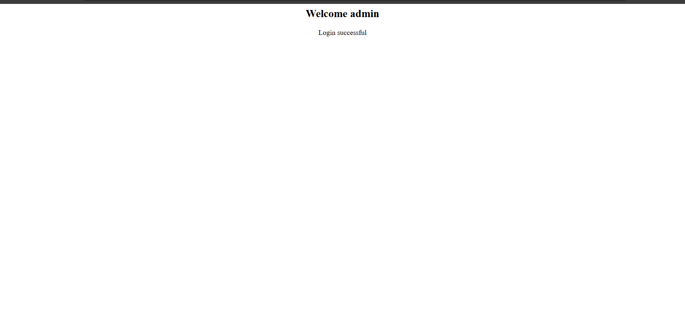
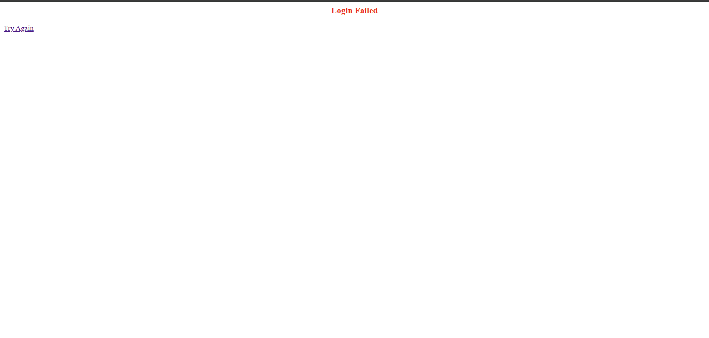
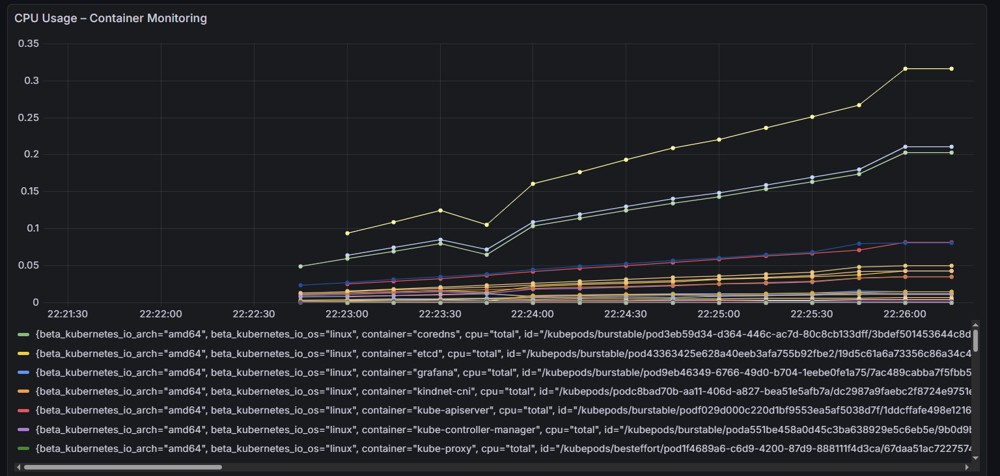
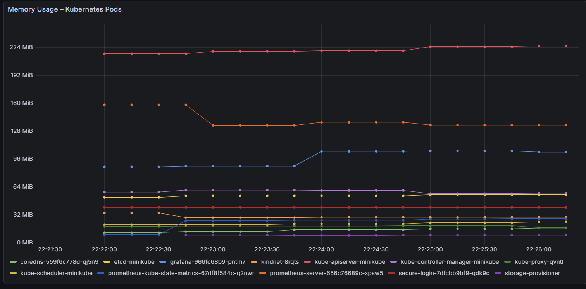
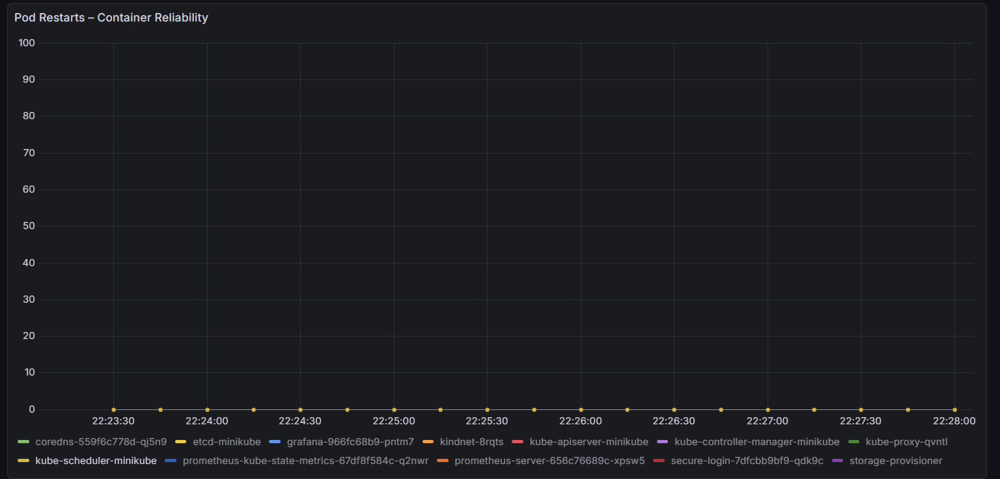
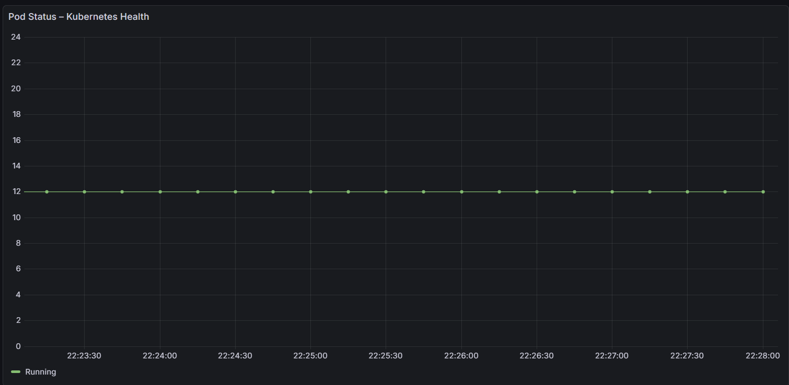

# Secure Login System – DevOps Implementation

## Project Overview

Originally developed as a university project for CS471 Computer Security, this project was extended to apply practical DevOps skills.

The application is built with Python and Flask and demonstrates secure login functionality. The DevOps extension focuses on containerization, automated testing, continuous integration, Kubernetes deployment, and infrastructure monitoring.

## Key DevOps Practices

- **Docker & Docker Compose:** Containerization and local application management.
- **Git & GitHub:** Version control and source code management.
- **GitHub Actions:** Automated CI workflow for testing and Docker image building.
- **Automated Testing:** Unit testing using Python `unittest`.
- **Kubernetes & Minikube:** Deploying and exposing the application in a local Kubernetes cluster.
- **Helm:** Installing and managing Kubernetes monitoring components.
- **Prometheus:** Collecting Kubernetes and container metrics.
- **Grafana:** Visualizing monitoring metrics through dashboards.

This project demonstrates practical application of DevOps tools to improve automation, deployment, testing, and operational visibility.

## Technologies Used

- Python & Flask
- SQLite
- Docker & Docker Compose
- Gunicorn
- Git & GitHub
- GitHub Actions
- Python Unittest
- Kubernetes
- Minikube
- Helm
- Prometheus
- Grafana

## Running the Project

### Prerequisites

- Docker Desktop
- Docker Compose

### Build and Run

Clone the repository:

```bash
git clone https://github.com/Reemaaldajani/secure-login-system.git
```

Navigate to the project directory:

```bash
cd secure-login-system
```

Build and start the application:

```bash
docker compose up --build
```

Open the application in your browser:

http://localhost:5001

### Stop the Application

```bash
docker compose down
```

## Automated Testing

The project includes automated tests using Python `unittest`.

To run the tests locally:

```bash
python -m unittest discover -v
```

The tests are also executed automatically through GitHub Actions as part of the CI workflow.

## Continuous Integration (CI)

GitHub Actions automates the CI workflow whenever code is pushed or a pull request is created on the `main` branch.

The workflow is located at:

```text
.github/workflows/docker-build.yml
```

The workflow includes:

- Checking out the repository.
- Setting up Python.
- Installing dependencies.
- Running automated tests.
- Building the Docker image.

**Current scope:** The workflow validates the application and builds the Docker image. It does not currently publish the image to a container registry or automatically deploy it to Kubernetes.

## Kubernetes Deployment

The application was deployed to a local Kubernetes cluster using **Minikube**.

The project includes the following Kubernetes manifests:

- `kubernetes/deployment.yaml` – Defines the application Deployment and Pod configuration.
- `kubernetes/service.yaml` – Exposes the application through a NodePort Service.

### Prerequisites

- Docker Desktop
- Minikube
- `kubectl`

### Build and Load the Image

The current Deployment uses a locally available image in Minikube:

```bash
docker build -t secure-login-system:latest .
minikube image load secure-login-system:latest
```

### Apply Kubernetes Manifests

```bash
kubectl apply -f kubernetes/deployment.yaml
kubectl apply -f kubernetes/service.yaml
```

### Verify the Deployment

```bash
kubectl get nodes
kubectl get deployments
kubectl get pods
kubectl get services
```

### Access the Application

```bash
minikube service secure-login-service --url
```

The Service is configured as a `NodePort` and uses port `30080`.

**Environment note:** The current Deployment uses `imagePullPolicy: Never`, which is suitable for the local Minikube setup after loading the image. A registry-based image workflow and deployment configuration would be needed for a remote Kubernetes cluster.

## Monitoring & Observability – Prometheus and Grafana

Prometheus and Grafana were installed in the Kubernetes cluster using Helm. They provide visibility into Kubernetes and container resource usage.

### 1. Create the Monitoring Namespace

```bash
kubectl create namespace monitoring
```

If the namespace already exists, this step can be skipped.

### 2. Add the Helm Repositories

```bash
helm repo add prometheus-community https://prometheus-community.github.io/helm-charts
helm repo add grafana https://grafana.github.io/helm-charts
helm repo update
```

### 3. Install Prometheus

```bash
helm upgrade --install prometheus prometheus-community/prometheus `
  --namespace monitoring `
  --set alertmanager.enabled=false `
  --set kube-state-metrics.enabled=true `
  --set prometheus-node-exporter.enabled=false `
  --set prometheus-pushgateway.enabled=false `
  --set server.persistentVolume.enabled=false `
  --set server.resources.requests.memory=256Mi `
  --set server.resources.requests.cpu=100m `
  --set server.resources.limits.memory=512Mi `
  --set server.resources.limits.cpu=500m
```

The backtick (`) line continuation above is for PowerShell. On Bash or Linux, replace each trailing backtick with `\`.

### 4. Install Grafana

```bash
helm upgrade --install grafana grafana/grafana `
  --namespace monitoring `
  --set persistence.enabled=false `
  --set resources.requests.memory=128Mi `
  --set resources.requests.cpu=100m `
  --set resources.limits.memory=512Mi `
  --set resources.limits.cpu=500m
```

The backtick (`) line continuation above is for PowerShell. On Bash or Linux, replace each trailing backtick with `\`.

### 5. Verify the Monitoring Components

```bash
kubectl get pods -n monitoring
kubectl get services -n monitoring
```

The Prometheus, Grafana, and kube-state-metrics Pods should reach the `Running` state before proceeding.

### 6. Access Grafana

Forward the Grafana Service to the local machine:

```bash
kubectl port-forward -n monitoring svc/grafana 3000:80
```

Open Grafana:

http://localhost:3000

The default username is:

```text
admin
```

Retrieve the generated password in PowerShell:

```powershell
$encoded = kubectl get secret -n monitoring grafana -o jsonpath='{.data.admin-password}'
[Text.Encoding]::UTF8.GetString([Convert]::FromBase64String($encoded))
```

Keep the port-forward terminal running while accessing Grafana.

### 7. Configure Prometheus as a Grafana Data Source

In Grafana:

1. Open **Connections**.
2. Select **Add new connection**.
3. Search for and select **Prometheus**.
4. Set the Prometheus server URL to:

```text
http://prometheus-server.monitoring.svc.cluster.local
```

5. Select **Save & test** and verify that Grafana successfully queries the Prometheus API.

### 8. Grafana Monitoring Dashboard

A custom dashboard was created to visualize Kubernetes and container metrics, including:

- **CPU Usage – Container Monitoring:** Tracks CPU consumption by containers.
- **Memory Usage – Kubernetes Pods:** Displays memory consumption by Pod.
- **Pod Restarts – Container Reliability:** Tracks container restart activity.
- **Pod Status – Kubernetes Health:** Shows the running status of Kubernetes Pods.

These panels help identify resource usage, unexpected restarts, and workload health in the local Kubernetes cluster.

**Monitoring configuration note:** Persistent storage was disabled for the current Prometheus and Grafana installations. Monitoring data and dashboard changes may be lost if the relevant Pods are recreated. Persistent storage can be enabled as a future improvement.

## Application Screenshots

### Successful Login


### Failed Login


### Account Locked


### 8. Grafana Monitoring Dashboard

A custom dashboard was created to visualize Kubernetes and container metrics, including:

- **CPU Usage – Container Monitoring:** Tracks CPU consumption by containers.
- **Memory Usage – Kubernetes Pods:** Displays memory consumption by Pod.
- **Pod Restarts – Container Reliability:** Tracks container restart activity.
- **Pod Status – Kubernetes Health:** Shows the running status of Kubernetes Pods.

These panels help identify resource usage, unexpected restarts, and workload health in the local Kubernetes cluster.

**Monitoring configuration note:** Persistent storage was disabled for the current Prometheus and Grafana installations. Monitoring data and dashboard changes may be lost if the relevant Pods are recreated. Persistent storage can be enabled as a future improvement.

## Grafana Monitoring Screenshots

The following screenshots demonstrate the monitoring dashboards configured with Grafana and Prometheus in the local Minikube environment.

### CPU Usage – Container Monitoring



Tracks CPU consumption reported for the monitored containers.

### Memory Usage – Kubernetes Pods



Displays memory usage for Kubernetes Pods.

### Pod Restarts – Container Reliability



Shows container restart activity over the selected time range.

### Pod Status – Kubernetes Health



Shows the number of Pods by their reported Kubernetes phase.